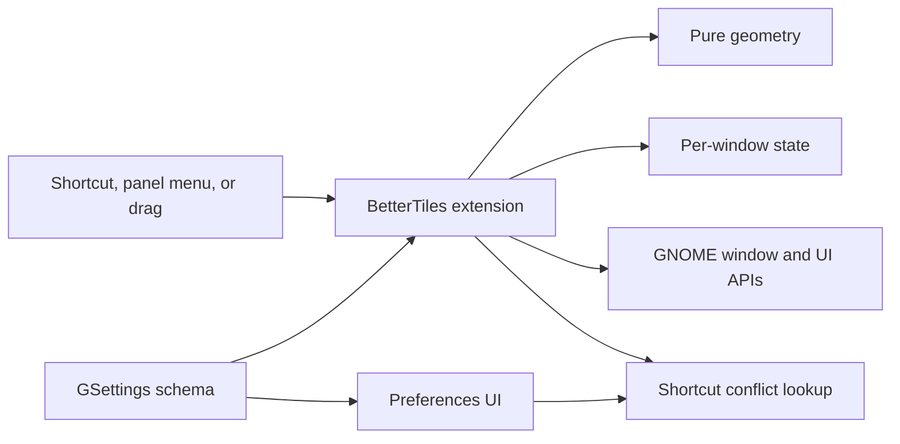

# Architecture

Better Tiles is a GNOME Shell 51 extension. Shell loads the compiled `dist/extension.js` module; GNOME's preferences process loads `dist/prefs.js` separately. Both use the same GSettings schema, so a preference change reaches the running extension through settings signals.

## Module map

| Module | Responsibility |
| --- | --- |
| `src/extension.ts` | Shell entry point, resource lifecycle, window actions, drag events, shortcut registration, preview, and panel menu |
| `src/actions.ts` | Action, layout, and edge identifiers with their display labels |
| `src/geometry.ts` | Pure rectangle calculations, edge detection, and monitor transfer |
| `src/window-state.ts` | Per-window undo history and the previous size used by restore-on-drag |
| `src/shortcuts.ts` | Shortcut normalization and lookup of conflicting GNOME bindings |
| `src/prefs.ts`, `src/preferences.ts` | Preferences entry point and GTK/libadwaita settings UI |
| `schemas/*.gschema.xml` | Persisted settings, defaults, ranges, and allowed edge actions |

The extension is the coordinator at the GNOME boundary. Geometry and window history contain the rules that can run without Shell. UI construction stays in the preferences process. This separation keeps Shell objects and signal lifetimes out of the geometry code; adding interfaces or inheritance layers around GNOME APIs would add complexity without a current use case.

## Window action flow

Shortcuts and panel items call `perform()`. A completed edge drag also calls it, after Mutter ends its grab. `perform()` checks that the extension is active, the window is eligible, and the action is allowed for that window. It resolves an action to a layout and destination monitor, computes a rectangle in the destination work area, records the previous state, then moves or resizes the window. `center` preserves window size where possible. Unpadded `maximize` enters GNOME's maximized state; padded maximize uses an ordinary resized window.

Each tracked window has a `WindowState` with up to 20 undo snapshots. A snapshot records the frame rectangle, monitor, maximized state, and fullscreen state. `target` and `layout` describe the last tile applied by Better Tiles. They let monitor transfers preserve a known tile and let a later drag recognize a tiled window. Undo restores the saved window state and clears the tile marker. Monitor topology changes clear all window histories because saved monitor coordinates may no longer be valid.

Undo and restore-on-drag use different snapshots during a drag. Undo remembers the window at drag start. The restore size is the window's frame just before the new snap is applied; it may already have been returned to its floating size during that drag. `WindowState.remember()` takes both snapshots explicitly.

## Edge drag flow

`grab-op-begin` starts tracking an eligible moving window. A GLib timer samples the pointer, finds its physical monitor and active edge zone, applies the configured edge action or thirds modifier, and waits for the configured activation delay before showing a preview. Leaving the zone resets the candidate. Escape, overview entry, monitor changes, and extension shutdown cancel the preview.

`grab-op-end` commits only when the current event is a pointer button release and an active candidate remains. It schedules `perform()` on the idle loop so Mutter can finish grab cleanup first. Pending idle sources are removed on disable, display changes, or a new grab. A window's `unmanaged` signal removes its state and cancels its drag if needed.

## Settings and lifecycle

`enable()` creates settings, signals, the preview actor, shortcuts, and optionally the panel indicator. It temporarily disables GNOME's built-in edge tiling while Better Tiles snapping is enabled. A private GSettings key records whether GNOME's prior value was explicit or the default, so disable can restore it after a normal stop or a later restart. Settings changes rebuild affected bindings or UI and cancel an in-progress drag when its snap rules change.

`disable()` stops drag and idle sources, disconnects signals, removes shortcuts and UI actors, clears window state, and restores GNOME edge tiling when this extension had disabled it. Keep every new signal, timer, actor, or binding paired with cleanup here. Do not retain a `Meta.Window` after its `unmanaged` signal.

Shortcut registration checks GNOME's native bindings and skips a conflicting Better Tiles action. Preferences uses the same normalization and conflict lookup to show conflicts before saving a recorded shortcut. Action names and edge choices are also present in the GSettings schema; when adding one, update `src/actions.ts`, the relevant geometry or action handling, and the schema together.

## Build and validation

`npm run build` removes the old `dist/`, compiles TypeScript, copies metadata, CSS, license, and schemas, then compiles the GSettings schema. `npm run pack:extension` uses GNOME's packer to include every compiled helper module in the release ZIP. `npm test` runs the pure geometry and window-state tests against compiled code. `npm run typecheck` checks TypeScript without emitting files.

`npm run test:gnome` launches an isolated headless GNOME Shell with private D-Bus, settings, and two virtual monitors. Its harness exercises real windows, shortcuts, drag behavior, preferences, and disable/re-enable cleanup. It needs an environment that permits local D-Bus sockets and a headless GNOME Shell.
