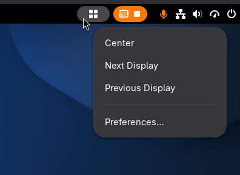
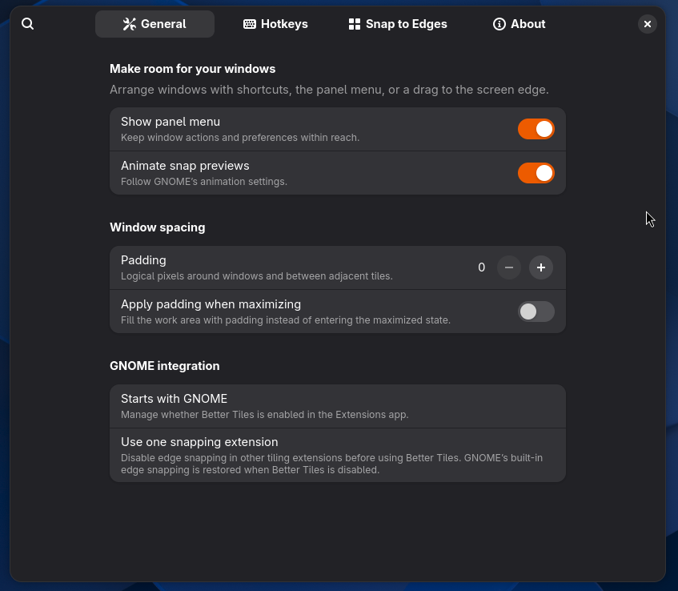
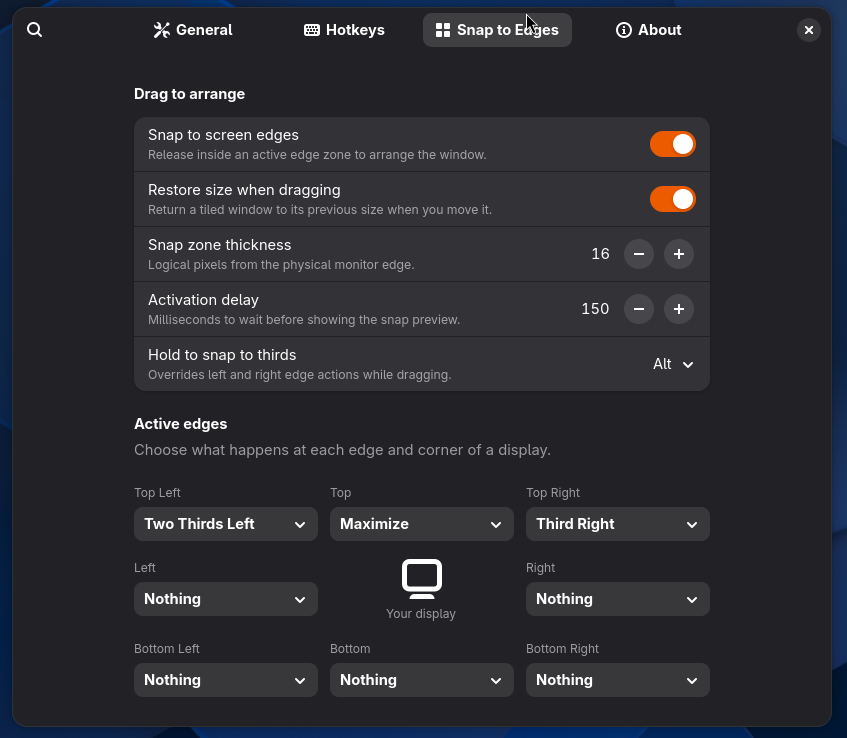

# Better Tiles

Better Tiles arranges application windows in GNOME Shell 51 on Wayland. Use keyboard shortcuts, drag a window to a screen edge, or choose an action from a small panel menu.

This project was coded with the help of Codex.

## What it does

- Tile windows into halves, quarters, thirds, or two-thirds of the usable screen area.
- Center or maximize a window, move it between displays, and undo the last 20 actions for each window.
- Preview a layout when you drag a window to an edge. Dragging a tiled window can restore its earlier floating size.
- Set padding, edge actions, snap timing, a thirds modifier, and individual shortcuts in native GTK4/libadwaita preferences.
- Leave GNOME's existing shortcut bindings in place: Better Tiles skips its own shortcut when it detects a conflict.

## Requirements

This source build targets **GNOME Shell 51 on Wayland**. Building it requires Node.js and npm, GJS, and GLib's `glib-compile-schemas`. Packaging also requires `gnome-extensions`. The preferences UI uses GTK4 and libadwaita. The extension metadata advertises GNOME Shell 51 only.

There is no extensions.gnome.org listing yet. The extension ID is `better-tiles@asdf-dev.github.io`.
If you installed the earlier `better-tiles@local` development build, disable and remove it before enabling this ID so the two copies do not compete for snapping and shortcuts.

## Install from source

From the project directory, run:

```sh
npm ci
npm run install:local
```

The installer builds the extension and copies it to `~/.local/share/gnome-shell/extensions/better-tiles@asdf-dev.github.io` or the equivalent path under `XDG_DATA_HOME`. It does not enable the extension. Log out and back in if GNOME has not discovered it, then enable **Better Tiles** in the Extensions app or run:

```sh
gnome-extensions enable better-tiles@asdf-dev.github.io
```

Open its settings from the Extensions app or with:

```sh
gnome-extensions prefs better-tiles@asdf-dev.github.io
```

You can preview the preferences before installing with `npm run prefs`. After installing a new build on Wayland, log out and back in to load the replacement code.

If you use another tiling extension, disable its edge snapping to avoid competing drag behavior. While Better Tiles snapping is enabled, it turns off GNOME's built-in edge tiling and restores the previous setting when Better Tiles is disabled. If GNOME Shell stops unexpectedly, Better Tiles restores the setting the next time it starts and is disabled. Until then, GNOME's built-in edge tiling may remain off.

## Try it in GNOME DevKit

On a GNOME 51 Wayland desktop, install the extension before starting the nested Shell:

```sh
npm ci
npm run install:local
dbus-run-session -- gnome-shell --devkit --wayland
```

Open a terminal **inside the DevKit window**, then enable Better Tiles and open its preferences:

```sh
gnome-extensions enable better-tiles@asdf-dev.github.io
gnome-extensions prefs better-tiles@asdf-dev.github.io
```

If DevKit was already running when you installed or rebuilt Better Tiles, close and start it again so it loads the new code. DevKit uses your user extension directory, so the local installation is also visible to your normal GNOME session. Some distributions require a separate `mutter-devkit` package; see the [GNOME extension development guide](https://gjs.guide/extensions/development/creating.html).

## Walkthrough

1. **Open the panel menu** to center a window, move it to another display, or open **Preferences**. Preferences are also available from the Extensions app.

   

2. **Set up General preferences.** Choose whether to show the panel menu and animate snap previews, then set the spacing around tiled windows.

   

3. **Choose what each screen edge does** on **Snap to Edges**. The image shows one customized layout; the default edge actions are listed below. Drag a window to an enabled edge, wait for the preview, and release to place it.

   

## Use Better Tiles

### Drag to an edge

Drag a normal application window to an edge and wait for the preview, then release to snap it. Corners select quarters, the left and right edges select halves, and the top edge maximizes. The bottom edge has no default action. Hold **Alt** at a left or right edge to choose a third; you can change or disable that modifier in preferences. Move away from the edge or press Escape to cancel a preview.

### Keyboard shortcuts

The default shortcuts start with **Super+Control+Alt**. Add the key shown below:

| Key | Action |
| --- | --- |
| Left / Right / Up / Down | Left / right / top / bottom half |
| C / F | Center / maximize |
| U / I / J / K | Upper left / upper right / lower left / lower right quarter |
| Period / Comma | Next / previous third |
| Shift+Left / Shift+Up / Shift+Right | Left / center / right two-thirds |
| Page Down / Page Up | Next / previous display |
| Z | Undo |

All 18 shortcuts can be changed or cleared on the **Hotkeys** preferences page. A conflicting GNOME shortcut is shown there and is not registered by Better Tiles.

### Panel menu and preferences

The panel menu offers **Center**, **Next Display**, **Previous Display**, and **Preferences**. You can hide the panel menu in preferences; settings remain available in the Extensions app.

The **General** page controls the menu, preview animation, and padding. **Hotkeys** records and resets shortcuts. **Snap to Edges** controls the eight edge actions, snap zone thickness, activation delay, thirds modifier, and restore-on-drag behavior.

## Behavior and limits

- Layouts use each monitor's work area, leaving room for the GNOME top bar. Coordinates and padding are logical pixels.
- Ordinary maximize enters GNOME's maximized state. With **Apply padding when maximizing**, Better Tiles sizes an ordinary window within the work area instead.
- Moving a tiled window to another display keeps its layout. Moving a floating window preserves its size where the destination has room.
- Undo stores up to 20 actions per window, including its monitor and fullscreen or maximized state. History clears when displays change or the extension is disabled.
- Fixed-size windows can be centered or moved between displays; actions that require resizing are skipped. Applications still control their minimum window size.
- Other extensions and application shortcuts can still conflict with Better Tiles and may need manual adjustment.

To stop using the extension, disable it in the Extensions app or run `gnome-extensions disable better-tiles@asdf-dev.github.io`. The local installer does not manage removal; after disabling, remove its directory from your user GNOME extensions folder if you want to uninstall it.

## Development and contributing

See [CONTRIBUTING.md](CONTRIBUTING.md) for setup, bug reports, and pull requests, and [ARCHITECTURE.md](ARCHITECTURE.md) for module boundaries and lifecycle details.

```sh
npm run typecheck
npm test
npm run test:gnome
npm run test:package
```

The GNOME integration tests run an isolated headless Shell with private D-Bus and two virtual monitors. `test:package` extracts the upload ZIP and compiles its schema before running the same checks. These tests do not change your current desktop's extension state. They need a host that allows local D-Bus sockets. Test artifacts are written to `.test-session/` and replaced on the next run.

Current manual coverage gaps include fractional scaling, physical display removal, non-US keyboard layouts, and coexistence with other tiling extensions.

## Package for review

Run `npm run pack:extension` to create `better-tiles@asdf-dev.github.io.shell-extension.zip` from a clean build. The package includes the compiled JavaScript modules, preferences, stylesheet, schema, metadata, and license. Run `npm run test:package`, then install that ZIP in a GNOME 51 desktop with `gnome-extensions install --force better-tiles@asdf-dev.github.io.shell-extension.zip` before uploading it to extensions.gnome.org. The extension does not download updates itself.

Better Tiles is licensed under [GPL-3.0-or-later](LICENSE).
